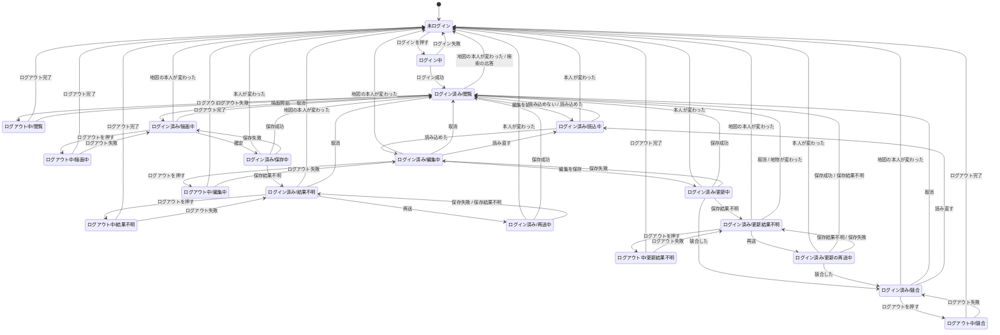

# 画面の状態図と操作の記録

最終更新: 2026-11-22

画面は、ログインから保存まで1つの状態機械(`src/lib/app/machine.ts`)で動く。この文書には、その状態図と、本物の画面を動かして状態ごとのスクリーンショットを撮る方法を置く(goal.md Phase 4)。

## ログイン中に権限が変わる

変更の流れから新しい権限が届くと、ヘッダーに今のロールと編集可否が出る。選択中の地物と一覧を消し、新しい権限で地図と一覧を読み直す。下書きや編集中の入力は残る。保存できる権限がなくなった場合は、その場で確定や編集の保存が押せなくなる。

応答を待っている画面はそのまま待ち続ける。結果不明の更新を送り直す間は「更新の再送中」と表示する。再送が拒否された場合は「更新結果不明」に戻り、再送が受け付けられず、前に送った更新は結果不明のままであることを表示する。

## 地図に反映されてから編集する

ポップアップの「版」は、描かれているタイル内の地物の版。地物の ID と版が DB の編集データと一致すれば編集を開く。版が違う場合は「地図へ反映中」と表示して、地図を読み直す。

デモの西区画と東区画は、北と南の2枚のタイルにまたがる。どちらかで編集を開き、画面で隣の区画をクリックして版を確認すると、共有境界の位置を選べる。古いタイルの区画をクリックすると選択が無効になる。保存すると両区画が同じ版に進む。

社内で見せるときは `pnpm drive --role admin --scenario shared-boundary --screenshot` で、両側が版0で揃った画面、南だけ新版を描いて境界がタイルの継ぎ目でずれた画面、両側が版1で揃い操作できる画面を撮る。SvelteKit は操作を差し出し、MapLibre はクリックされた断片の版を返し、PostGIS は両区画を一括で確定する。Lean は三者をつなぐ版の条件を証明し、Playwright は条件を破る操作が本物のブラウザでも通らないことを確かめる。

既存の開発DBでは、先にマイグレーション007を適用する。新しいサンプル区画を入れ直す場合は `pnpm db:reset` でデモデータに初期化できる。

## 状態図

モデル3が全探索でたどった遷移から作った(`model/state-diagram.ts`)。手では書かない。
下の図が生成した図と同じかは `model/state-diagram.test.ts` が確かめる。状態機械を変えてこの図を直さなければ、`pnpm test` が落ちる。



- 状態の名前は「アプリの状態/画面の状態」。ログアウト中は、ログアウトを押したときの画面を出したまま、結果を待つ
- 矢印に付いているのは状態機械のイベント名で、ボタンの文字とは少し違う。「確定」は「確定して保存」ボタン、結果不明からの「取消」は「やめる」ボタン
- 同じ状態にとどまる遷移(点の追加、ポップアップの開閉、市や公開の選択)は図に出さない

## 操作の記録(`pnpm drive`)

```sh
pnpm drive --role a-staff --scenario draw-and-save --screenshot
pnpm drive --scenario tour --screenshot   # 状態図の全状態を通る
```

- 開発サーバーを 5196 番に自分で立て、インストール済みの Chrome で画面を動かす。DB は前後でシードに戻す
- `--screenshot` を付けると、`evidence/<時刻>-<ロール>-<シナリオ>/` に状態ごとのスクリーンショットと `README.md`(手順と画面の表。`tour` では状態図も)を書く。`evidence/` は git に入れない
- 保存中・結果不明などの途中の状態は、ブラウザの中で通信を止めたり、決まった応答を返したりして作る(Playwright の `page.route`)。決まった手順で特定の状態を撮るためのもので、ランダムな障害を起こす `tests/ui/proxy.ts` とは目的が違う。ブラウザの中で止めるので、Chrome の自動再送(`docs/model-checking.md`)は起きない
- 操作の部品(`scripts/driver.ts`)は、E2E(`tests/e2e/`)と共有している

| シナリオ | 機能マップの行 | 通る状態 |
|---|---|---|
| `login` | ログインする | 未ログイン → ログイン中 → 閲覧 |
| `popup` | 地物をクリックして属性を見る | 閲覧(ポップアップ)。そのロールに見える点の地物をクリックする |
| `draw-and-save` | ポリゴンを描く、描いた地物を保存する | 描画中 → 保存中 → 閲覧 |
| `revoke-then-save` | 描画中に職員の編集権限を剥奪する | 「編集不可」が出て確定が押せなくなり、下書きは残る |
| `transfer` | A市職員でポップアップを開き、その職員を B市に異動する | A市のポップアップと一覧が消え、B市の地物を読み直す。ロールは `a-staff` |
| `shared-boundary` | 両区画を確認して境界を保存し、北のタイルに旧版を残す | 画面に版が混在する間は共有境界の操作が無効。両側の新版を確認すると操作できる |
| `change-notice` | 編集中に、ほかの人の保存を知らされる | 編集中 →(もう1つのブラウザで別の人が保存)→ 編集中(「ほかの人が更新した」と読み直すボタン) |
| `search` | 地図に見えている範囲の地物の一覧を見る | 閲覧(一覧)→ 拡大して検索中(前の一覧を薄く出す)→ 閲覧(拡大した範囲の一覧) |
| `tour` | ログイン、ポップアップ、描画、保存と再送、ログアウト、編集、競合と更新の再送 | 状態図の19状態すべて。撮れなかった状態があれば失敗する |

描くシナリオは閲覧者では流せない(描画ボタンが押せない)。

## 照合で見つかったこと(2026-11-20)【測定】

`tour` のスクリーンショットを状態図と並べると、ログアウト中の画面が図と合っていなかった。

- 図では、ログアウト中から出る矢印はログアウト完了とログアウト失敗だけ。利用者が何を押しても状態は変わらない
- 画面では、押せなくなるのはログアウトボタンだけだった。ポリゴンを描く・確定して保存・取消・再送する・やめるのボタンと「公開する」は、押せるように見えていた。押しても状態機械が無視するので、何も起きない
- 最初は、パネルの中身を `fieldset` で包み、ログアウト中は丸ごと押せなくして直した。これは1つの状態に当てた応急処置で、根本の原因は残っていた(下の「2026-11-21 の作り直し」)

UI の性質テスト(`tests/ui/app.spec.ts`)にも「ログアウト中は何も押せない」を足した。
もとからあった「結果不明では再送するかやめるしか選べない」は、ログアウト中/結果不明では必ず破れる書き方だった(ログアウトボタンの文字が「ログアウト中…」になる)。それでも探索が緑だったので、探索はこの状態に一度も届いていなかったことになる。ログイン済みのときだけを見るように直した。

確かめた結果【測定】: 直した画面を3分探索して、性質はすべて成り立った(ログアウト中/結果不明も1状態観測した)。`fieldset` から `disabled` を外した版では、「ログアウト中は何も押せない」が11状態で破れた。詳しくは `docs/model-checking.md` の「本物の画面の性質テスト」。

## 2026-11-21 の作り直し: 押せるかは状態機械が決める

ログアウト中のずれの根本の原因は、状態機械が「その状態で何ができるか」を外に出しておらず、画面が同じ条件を自分で書き直していたこと。
画面には状態機械と同じ条件が5つあり(描画は編集できる人だけ、市を選べるのは管理者だけ、確定は3点から、保存中はログアウトできない、ログアウト中は何も受け付けない)、最後の1つを写し忘れていた。

作り直して、画面は状態機械が差し出した操作しか持てないようにした。

- `src/lib/app/machine.ts`: イベントを、利用者の操作(`Op`)と副作用の応答(`Reply`)に分けた。`offers(状態)` が、その状態で差し出す操作の遷移そのものを返す。差し出していない操作には遷移がないので、送る手段がない。`receive(状態, 応答)` は、受け取れない応答には `undefined` を返す(黙って無視しない)
- `src/lib/app/app.svelte.ts`: 画面とのつなぎ役。状態を持てるのはここだけ。画面に渡すのは今の状態と、差し出された操作(`actions`)だけ。受け取れない応答が届いたら例外を投げる(本物の画面では Bombadil の `noUnhandledPromiseRejections` が拾う)
- `src/lib/ui/Action*.svelte`: ボタン・チェックボックス・選択は、操作を受け取る部品だけにした。操作が差し出されていなければ、部品が自分で押せなくなる
- `eslint.config.ts`: 画面に生の `<button>` などを書けない。画面は状態機械の関数を呼べない(型は使える)。`$state` を持てるのはつなぎ役だけ。わざと違反させたファイルで、どれもエラーになることを確かめた
- 画面に残った条件は、状態ごとのレイアウトの分岐と、「編集不可」の表示だけ。`fieldset` と5つの条件は消えた

権限がなくて使えない操作(閲覧者の「ポリゴンを描く」、市職員の「市の選択」)は、隠さずに押せない状態で出すことにした(2026-11-21 に決めた)。画面に条件を書かずに済み、できないことが見える。

ハイドレーションの前も同じ種類のずれがあった。サーバーが描いた HTML ではボタンが押せるように見えるのに、ハイドレーションが終わるまで押しても何も起きない。
つなぎ役は、ブラウザで画面がつながるまで(`onMount` が走るまで)操作を差し出さないようにした。サーバーが描いた HTML のボタンは押せない状態で出て、ハイドレーションのあとに押せるようになる【測定】。テストは、押せるボタンが出るまで待つだけでよくなり、テストのための目印(`data-hydrated`)を消した。

サインインの応答に本人の ID がないときは、要求に本人を書けない(P11)ので、ログイン失敗にする(前は空の ID にしていた)。

確かめた結果【測定】:

- モデル3の全状態数は、作り直す前と同じ 73,011。わざと壊した版の反例の手順も、作り直す前と同じになった
- 状態図(この文書の先頭)は変わらなかった(そのあと P11 で、本人違いの矢印が増えた)
- `tour` で10状態を撮り直した。ログアウト中は、`fieldset` なしでも全部押せない
- UI の性質テストで、ボタンの部品が押せなさを無視する版を2分探索すると、「保存中はログアウトできない」(1,472状態)・「閲覧者は描けない」(321状態)・「ログアウト中は何も押せない」(6状態)が破れた

## 画面とサーバーで本人がずれる(2026-11-21 に見つけて直した。P11)

作り直したあとの UI の性質テスト(3分)で、P1「市職員には自分の市の地物だけが出る」が1回破れた。B市職員と表示している画面で、A市の非公開の地物(所有者名つき)がポップアップに出た。

トレースを読むと、作り直しとは関係なく、前からあった問題だった。

1. A市職員のログインの通信が飛んでいる間に、ページを再読み込みした
2. 再読み込みした時点の Cookie は B市職員だったので、画面は B市職員として表示された
3. そのあとに、さっきのログインの応答が届き、Cookie が A市職員に置き換わった
4. 地図ライブラリ(MapLibre)がタイルを取り直すと、A市職員として認可されたタイルが届いた

タブを2つ開いて、片方でログインし直しても同じことが起きる。決まった手順で再現した【測定】。B市職員と表示したタブの Cookie の本人は `a-staff@example.com` だった。このタブで保存すれば、A市職員として認可される。

サーバーの認可は正しく働いている(その Cookie の本人に見せてよいものだけを返している)。ずれているのは、画面が思っている本人と、サーバーが認可に使う本人。
原因は、タイルの通信を地図ライブラリが自分で行っていて、状態機械の外にあること。状態機械のモデルにも Cookie が入っていなかった。

goal.md 4章に P11(本人の一致)として足し、次のように直した。

- 本人(`Me`)に ID を足した。画面のデータの要求には、画面が表示している本人の ID を `as` に書く。タイルの URL も、状態機械の状態(本人とタイルの版)から作る。地図ライブラリが誰としてタイルを取りに行くかを、状態機械が決める
- サーバーは、`as` がセッションの本人と違えば 412 で答えない(`requireActor`。`as` なしでは呼べない)。これだけで、ずれた本人のデータは画面に出なくなる(地図は空になる)
- 地図の 412 は、知らせ(`地図の本人が変わった`)として状態機械に届く。閲覧中・描画中・結果不明ならログイン画面に戻り、理由を出す。保存中・ログアウト中は何もしない。飛んでいる応答を捨てないためで、これは証明が決めた(`docs/proofs.md`)。保存の要求にも本人を書いてあるので、保存中の本人違いは保存の応答(`本人が変わった`)で分かる

確かめた結果【測定】:

- 2つのタブの E2E(`tests/e2e/identity.test.ts`): 元のタブで地図を拡大すると、タイルはすべて 412 で断られ、ログイン画面に戻って理由が出た
- 性質テスト(`tests/properties/p11-identity.test.ts`): 4つの出口(一覧・範囲検索・タイル・作成)で、別の本人を書いた要求と本人を書かない要求は 412、自分を書いた要求は 412 にならない
- わざと壊した版:
  - サーバーが `as` を見ない版では、性質テストと2つのタブの E2E が赤になった
  - 画面が知らせを無視する版では、2つのタブの E2E と、Lean の仕様との突き合わせが赤になった

## 既存の地物の編集(2026-11-21、Phase 5 の事例研究1)

地物を選んでポップアップの「編集を始める」を押すと、サーバーから今の版を読み込み(読込中)、名前と備考を編集できる(編集中)。保存すると更新中になり、結果で分かれる。

- 成功: 閲覧に戻る(タイルを読み直す)
- 競合(ほかの人が先に保存していた): 競合の画面。読み直すか、やめるしか選べない。読み直すまで更新は送らない(P4)。自分の編集は画面に出しておく
- 拒否: 編集中に戻り、理由を出す
- 結果が分からない: 再送するか、やめる。再送は同じ中身・同じキーで送るので、もう効いていても自分の更新と競合しない(P12)

「編集を始める」を差し出すのは、本人がその地物を書き込めるとき(認可の仕様と同じ判断)だけ。名前と備考の入力も、操作を受け取る部品(`ActionTextInput`)だけで行う。

## 見えている範囲の一覧(2026-11-21、Phase 5 の事例研究2)

地図を動かすと、見えている範囲の地物を左下の一覧に出す(範囲検索 API)。動かすたびに検索を送り、前の検索の応答を待たない。
応答は送った順に届くとは限らないので、状態機械は次のように受け取る。

- 検索には、タブの中で一度きりの番号を振る。応答を待つのは、いちばん新しい検索だけ。それより前の検索の応答は、届いても何も変えずに捨てる(受け取りはする)
- 検索中は、前の一覧を薄くして出したまま「更新中…」と出す。検索中でなければ、一覧は今見えている範囲のもの(P13)
- 地図と番号はタブのもので、ログインと関係なく続く(状態機械の `MapView`)。画面も、ログインしていないときに地図を消さず、その上にログインの画面を重ねる。ログアウトしたあとも前の本人の検索の応答は届くので、番号を振り直すと取り違える(`docs/model-checking.md` の検索の範囲)
- 検索の「本人が変わった」(412)は、いちばん新しい検索への応答だけを信じる。ほかの応答を待っている間は、タイルの本人違いと同じく、画面を止めない
- 保存が終わったとき・結果不明の下書きをやめたとき・ログアウトに失敗したときは、一覧を読み直す(応答を受け取って副作用を出すのは、この検索だけ)
- ログアウト中は一覧を止めておき、「止めている」と分かるように薄く出す

地図に見えている範囲は、地図の子の部品(`#lib/ui/MapArea.svelte`)が、地図ができたときと動き終わるたびに知らせる。地図の `load` は背景地図のタイルを読み終えるまで来ないので使わない(E2E で、タイルが遅いと一覧が出ないことがあった)。

## ほかの人の保存を、その場で知る(2026-11-22、Phase 5 の事例研究3)

ログインしている間、画面は変更の流れ(`/api/events`、Server-Sent Events)を本人として開いておく。サーバーは、更新や作成が効いて commit されたとき、その地物を読める人の流れにだけ、地物の id・版・効いた要求のキーを流す。

- どの画面でも、地図と一覧を読み直す
- 編集中で、編集している地物が読み込んだときより新しい版になったら、「ほかの人が更新しました」と出し、読み直すボタンを出す。打った編集は消さない(このまま保存すると競合になる。P4)。自分の更新が戻ってきた知らせは、読み込んだ版と同じなので出さない
- 更新中に、自分の更新のキーの知らせが届いたら、効いたと覚える。応答待ちは抜けない(抜けると更新の応答を捨てる)。そのあと応答が結果不明(504 など)でも、効いていたので成功にする
- 更新結果不明のときに、自分の更新のキーの知らせが届いたら、効いていたので成功にする(送り直さずに済む)
- ログインし直す前の流れから遅れて届いた知らせは捨てる。流れが切れたらつなぎ直し、つなぎ直したら(取りこぼしたかもしれないので)地図と一覧を読み直す
- 流れの本人違い(412)は、タイルの本人違いと同じ知らせ(地図の本人が変わった)として扱う

サーバーは、PostgreSQL の知らせ(LISTEN)をプロセスに1本の接続で受けて配る。開発サーバーの再読み込みのあとに流れを3本開いても、LISTEN している接続は1本だった【測定】。流れの最初の1行(つながった)は、LISTEN を始めてから送る。最初は先に送っていて、流れを開いた直後に commit された変更を取りこぼす隙間があった(接続の数を手で数えて気づいた)。手で見つけたものなので、決まった入力の単体テスト(`src/lib/server/authz/changes.test.ts`)にした。購読の開始を手で進め、始まる前には1行も届かないことを確かめる。先に送る版では赤になる【測定】。届いた変更を1つずつ確かめて順番を保つことも、同じファイルで確かめ、1つずつ確かめない版では赤になる【測定】

流れを受け取るのは `src/lib/app/effects.ts` の `subscribeChanges` で、`app.svelte.ts` がログインしている本人について開く。状態機械の副作用ではなく、地図のタイルと同じく、状態機械の外で受けて知らせとして渡す(流れは1回の応答で終わらないので、副作用と応答の形に合わない)。
