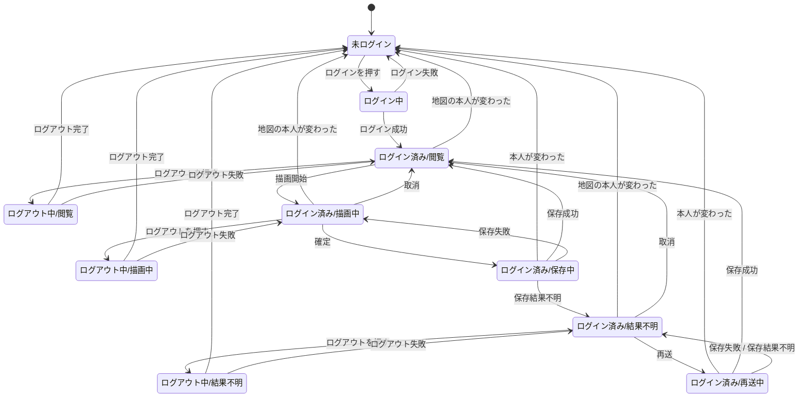

# 画面の状態図と操作の記録

最終更新: 2026-11-20

画面は、ログインから保存まで1つの状態機械(`src/lib/app/machine.ts`)で動く。この文書には、その状態図と、本物の画面を動かして状態ごとのスクリーンショットを撮る方法を置く(goal.md Phase 4)。

## 状態図

モデル3が全探索でたどった遷移から作った(`model/state-diagram.ts`)。手では書かない。
下の図が生成した図と同じかは `model/state-diagram.test.ts` が確かめる。状態機械を変えてこの図を直さなければ、`pnpm test` が落ちる。



- 状態の名前は「アプリの状態/画面の状態」。ログアウト中は、ログアウトを押したときの画面を出したまま、結果を待つ
- 矢印に付いているのは状態機械のイベント名で、ボタンの文字とは少し違う。「確定」は「確定して保存」ボタン、結果不明からの「取消」は「やめる」ボタン
- 同じ状態にとどまる遷移(点の追加、ポップアップの開閉、市や公開の選択)は図に出さない

## 操作の記録(`pnpm drive`)

```sh
pnpm drive --role a-staff --scenario draw-and-save --screenshot
pnpm drive --scenario tour --screenshot   # 状態図の全状態を通る
```

- 開発サーバーを 5196 番に自分で立て、インストール済みの Chrome で画面を動かす。DB は前後でシードに戻す
- `--screenshot` を付けると、`evidence/<時刻>-<ロール>-<シナリオ>/` に状態ごとのスクリーンショットと `README.md`(手順と画面の表。`tour` では状態図も)を書く。`evidence/` は git に入れない
- 保存中・結果不明などの途中の状態は、ブラウザの中で通信を止めたり、決まった応答を返したりして作る(Playwright の `page.route`)。決まった手順で特定の状態を撮るためのもので、ランダムな障害を起こす `tests/ui/proxy.ts` とは目的が違う。ブラウザの中で止めるので、Chrome の自動再送(`docs/model-checking.md`)は起きない
- 操作の部品(`scripts/driver.ts`)は、E2E(`tests/e2e/`)と共有している

| シナリオ | 機能マップの行 | 通る状態 |
|---|---|---|
| `login` | ログインする | 未ログイン → ログイン中 → 閲覧 |
| `popup` | 地物をクリックして属性を見る | 閲覧(ポップアップ)。そのロールに見える点の地物をクリックする |
| `draw-and-save` | ポリゴンを描く、描いた地物を保存する | 描画中 → 保存中 → 閲覧 |
| `revoke-then-save` | 職員の編集権限を剥奪する、描いた地物を保存する | 描画中 →(管理者が剥奪)→ 描画中(保存失敗)→ 再読み込みで「編集不可」 |
| `tour` | 上の全部と、保存の結果が分からないとき・ログアウト | 状態図の10状態すべて。撮れなかった状態があれば失敗する |

描くシナリオは閲覧者では流せない(描画ボタンが押せない)。

## 照合で見つかったこと(2026-11-20)【測定】

`tour` のスクリーンショットを状態図と並べると、ログアウト中の画面が図と合っていなかった。

- 図では、ログアウト中から出る矢印はログアウト完了とログアウト失敗だけ。利用者が何を押しても状態は変わらない
- 画面では、押せなくなるのはログアウトボタンだけだった。ポリゴンを描く・確定して保存・取消・再送する・やめるのボタンと「公開する」は、押せるように見えていた。押しても状態機械が無視するので、何も起きない
- 最初は、パネルの中身を `fieldset` で包み、ログアウト中は丸ごと押せなくして直した。これは1つの状態に当てた応急処置で、根本の原因は残っていた(下の「2026-11-21 の作り直し」)

UI の性質テスト(`tests/ui/app.spec.ts`)にも「ログアウト中は何も押せない」を足した。
もとからあった「結果不明では再送するかやめるしか選べない」は、ログアウト中/結果不明では必ず破れる書き方だった(ログアウトボタンの文字が「ログアウト中…」になる)。それでも探索が緑だったので、探索はこの状態に一度も届いていなかったことになる。ログイン済みのときだけを見るように直した。

確かめた結果【測定】: 直した画面を3分探索して、性質はすべて成り立った(ログアウト中/結果不明も1状態観測した)。`fieldset` から `disabled` を外した版では、「ログアウト中は何も押せない」が11状態で破れた。詳しくは `docs/model-checking.md` の「本物の画面の性質テスト」。

## 2026-11-21 の作り直し: 押せるかは状態機械が決める

ログアウト中のずれの根本の原因は、状態機械が「その状態で何ができるか」を外に出しておらず、画面が同じ条件を自分で書き直していたこと。
画面には状態機械と同じ条件が5つあり(描画は編集できる人だけ、市を選べるのは管理者だけ、確定は3点から、保存中はログアウトできない、ログアウト中は何も受け付けない)、最後の1つを写し忘れていた。

作り直して、画面は状態機械が差し出した操作しか持てないようにした。

- `src/lib/app/machine.ts`: イベントを、利用者の操作(`Op`)と副作用の応答(`Reply`)に分けた。`offers(状態)` が、その状態で差し出す操作の遷移そのものを返す。差し出していない操作には遷移がないので、送る手段がない。`receive(状態, 応答)` は、受け取れない応答には `undefined` を返す(黙って無視しない)
- `src/lib/app/app.svelte.ts`: 画面とのつなぎ役。状態を持てるのはここだけ。画面に渡すのは今の状態と、差し出された操作(`actions`)だけ。受け取れない応答が届いたら例外を投げる(本物の画面では Bombadil の `noUnhandledPromiseRejections` が拾う)
- `src/lib/ui/Action*.svelte`: ボタン・チェックボックス・選択は、操作を受け取る部品だけにした。操作が差し出されていなければ、部品が自分で押せなくなる
- `eslint.config.ts`: 画面に生の `<button>` などを書けない。画面は状態機械の関数を呼べない(型は使える)。`$state` を持てるのはつなぎ役だけ。わざと違反させたファイルで、どれもエラーになることを確かめた
- 画面に残った条件は、状態ごとのレイアウトの分岐と、「編集不可」の表示だけ。`fieldset` と5つの条件は消えた

権限がなくて使えない操作(閲覧者の「ポリゴンを描く」、市職員の「市の選択」)は、隠さずに押せない状態で出すことにした(2026-11-21 に決めた)。画面に条件を書かずに済み、できないことが見える。

確かめた結果【測定】:

- モデル3の全状態数は、作り直す前と同じ 73,011。わざと壊した版の反例の手順も、作り直す前と同じになった
- 状態図(この文書の先頭)は変わらなかった(そのあと P11 で、本人違いの矢印が増えた)
- `tour` で10状態を撮り直した。ログアウト中は、`fieldset` なしでも全部押せない
- UI の性質テストで、ボタンの部品が押せなさを無視する版を2分探索すると、「保存中はログアウトできない」(1,472状態)・「閲覧者は描けない」(321状態)・「ログアウト中は何も押せない」(6状態)が破れた

## 画面とサーバーで本人がずれる(2026-11-21 に見つけて直した。P11)

作り直したあとの UI の性質テスト(3分)で、P1「市職員には自分の市の地物だけが出る」が1回破れた。B市職員と表示している画面で、A市の非公開の地物(所有者名つき)がポップアップに出た。

トレースを読むと、作り直しとは関係なく、前からあった問題だった。

1. A市職員のログインの通信が飛んでいる間に、ページを再読み込みした
2. 再読み込みした時点の Cookie は B市職員だったので、画面は B市職員として表示された
3. そのあとに、さっきのログインの応答が届き、Cookie が A市職員に置き換わった
4. 地図ライブラリ(MapLibre)がタイルを取り直すと、A市職員として認可されたタイルが届いた

タブを2つ開いて、片方でログインし直しても同じことが起きる。決まった手順で再現した【測定】。B市職員と表示したタブの Cookie の本人は `a-staff@example.com` だった。このタブで保存すれば、A市職員として認可される。

サーバーの認可は正しく働いている(その Cookie の本人に見せてよいものだけを返している)。ずれているのは、画面が思っている本人と、サーバーが認可に使う本人。
原因は、タイルの通信を地図ライブラリが自分で行っていて、状態機械の外にあること。状態機械のモデルにも Cookie が入っていなかった。

goal.md 4章に P11(本人の一致)として足し、次のように直した。

- 本人(`Me`)に ID を足した。画面のデータの要求には、画面が表示している本人の ID を `as` に書く。タイルの URL も、状態機械の状態(本人とタイルの版)から作る。地図ライブラリが誰としてタイルを取りに行くかを、状態機械が決める
- サーバーは、`as` がセッションの本人と違えば 412 で答えない(`requireActor`。`as` なしでは呼べない)。これだけで、ずれた本人のデータは画面に出なくなる(地図は空になる)
- 地図の 412 は、知らせ(`地図の本人が変わった`)として状態機械に届く。閲覧中・描画中・結果不明ならログイン画面に戻り、理由を出す。保存中・ログアウト中は何もしない。飛んでいる応答を捨てないためで、これは証明が決めた(`docs/proofs.md`)。保存の要求にも本人を書いてあるので、保存中の本人違いは保存の応答(`本人が変わった`)で分かる

確かめた結果【測定】:

- 2つのタブの E2E(`tests/e2e/identity.test.ts`): 元のタブで地図を拡大すると、タイルはすべて 412 で断られ、ログイン画面に戻って理由が出た
- 性質テスト(`tests/properties/p11-identity.test.ts`): 4つの出口(一覧・範囲検索・タイル・作成)で、別の本人を書いた要求と本人を書かない要求は 412、自分を書いた要求は 412 にならない
- わざと壊した版:
  - サーバーが `as` を見ない版では、性質テストと2つのタブの E2E が赤になった
  - 画面が知らせを無視する版では、2つのタブの E2E と、Lean の仕様との突き合わせが赤になった
