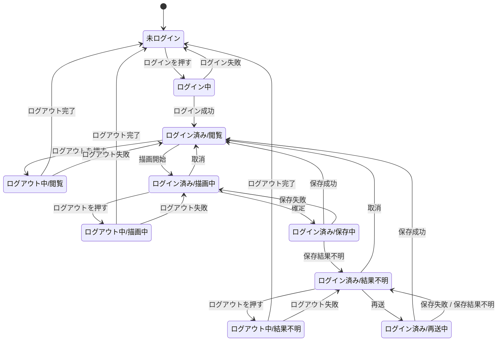

# 画面の状態図と操作の記録

最終更新: 2026-11-20

画面は、ログインから保存まで1つの状態機械(`src/lib/app/machine.ts`)で動く。この文書には、その状態図と、本物の画面を動かして状態ごとのスクリーンショットを撮る方法を置く(goal.md Phase 4)。

## 状態図

モデル3が全探索でたどった遷移から作った(`model/state-diagram.ts`)。手では書かない。
下の図が生成した図と同じかは `model/state-diagram.test.ts` が確かめる。状態機械を変えてこの図を直さなければ、`pnpm test` が落ちる。



- 状態の名前は「アプリの状態/画面の状態」。ログアウト中は、ログアウトを押したときの画面を出したまま、結果を待つ
- 矢印に付いているのは状態機械のイベント名で、ボタンの文字とは少し違う。「確定」は「確定して保存」ボタン、結果不明からの「取消」は「やめる」ボタン
- 同じ状態にとどまる遷移(点の追加、ポップアップの開閉、市や公開の選択)は図に出さない

## 操作の記録(`pnpm drive`)

```sh
pnpm drive --role a-staff --scenario draw-and-save --screenshot
pnpm drive --scenario tour --screenshot   # 状態図の全状態を通る
```

- 開発サーバーを 5196 番に自分で立て、インストール済みの Chrome で画面を動かす。DB は前後でシードに戻す
- `--screenshot` を付けると、`evidence/<時刻>-<ロール>-<シナリオ>/` に状態ごとのスクリーンショットと `README.md`(手順と画面の表。`tour` では状態図も)を書く。`evidence/` は git に入れない
- 保存中・結果不明などの途中の状態は、ブラウザの中で通信を止めたり、決まった応答を返したりして作る(Playwright の `page.route`)。決まった手順で特定の状態を撮るためのもので、ランダムな障害を起こす `tests/ui/proxy.ts` とは目的が違う。ブラウザの中で止めるので、Chrome の自動再送(`docs/model-checking.md`)は起きない
- 操作の部品(`scripts/driver.ts`)は、E2E(`tests/e2e/`)と共有している

| シナリオ | 機能マップの行 | 通る状態 |
|---|---|---|
| `login` | ログインする | 未ログイン → ログイン中 → 閲覧 |
| `popup` | 地物をクリックして属性を見る | 閲覧(ポップアップ)。そのロールに見える点の地物をクリックする |
| `draw-and-save` | ポリゴンを描く、描いた地物を保存する | 描画中 → 保存中 → 閲覧 |
| `revoke-then-save` | 職員の編集権限を剥奪する、描いた地物を保存する | 描画中 →(管理者が剥奪)→ 描画中(保存失敗)→ 再読み込みで「編集不可」 |
| `tour` | 上の全部と、保存の結果が分からないとき・ログアウト | 状態図の10状態すべて。撮れなかった状態があれば失敗する |

描くシナリオは閲覧者では流せない(描画ボタンが出ない)。

## 照合で見つかったこと(2026-11-20)【測定】

`tour` のスクリーンショットを状態図と並べると、ログアウト中の画面が図と合っていなかった。

- 図では、ログアウト中から出る矢印はログアウト完了とログアウト失敗だけ。利用者が何を押しても状態は変わらない
- 画面では、押せなくなるのはログアウトボタンだけだった。ポリゴンを描く・確定して保存・取消・再送する・やめるのボタンと「公開する」は、押せるように見えていた。押しても状態機械が無視するので、何も起きない
- パネルの中身を `fieldset` で包み、ログアウト中は丸ごと押せなくして薄く表示するようにした(`src/routes/+page.svelte`)

UI の性質テスト(`tests/ui/app.spec.ts`)にも「ログアウト中は何も押せない」を足した。
もとからあった「結果不明では再送するかやめるしか選べない」は、ログアウト中/結果不明では必ず破れる書き方だった(ログアウトボタンの文字が「ログアウト中…」になる)。それでも探索が緑だったので、探索はこの状態に一度も届いていなかったことになる。ログイン済みのときだけを見るように直した。

確かめた結果【測定】: 直した画面を3分探索して、性質はすべて成り立った(ログアウト中/結果不明も1状態観測した)。`fieldset` から `disabled` を外した版では、「ログアウト中は何も押せない」が11状態で破れた。詳しくは `docs/model-checking.md` の「本物の画面の性質テスト」。
